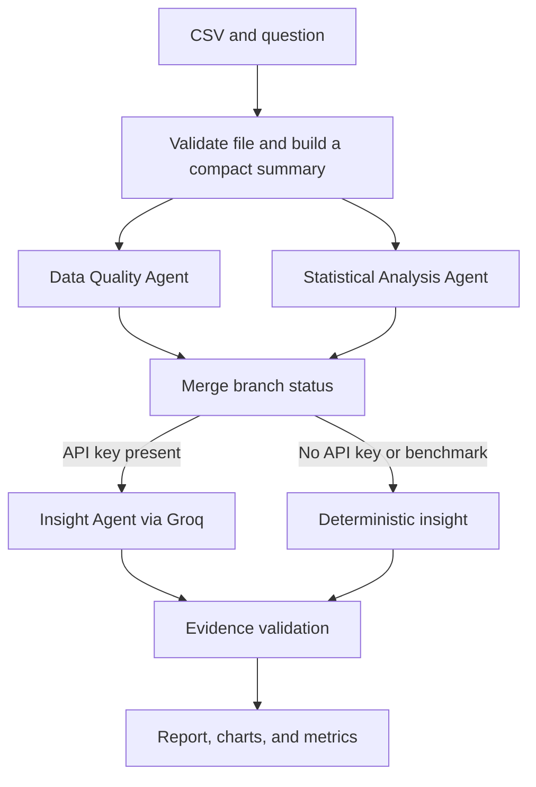

# DataPilot AI

DataPilot AI is a small multi-agent data analyst. You upload a CSV, optionally ask a question, and the app runs two specialist agents at the same time. One checks data quality. The other calculates statistics. An insight step then writes a report whose numbers are checked against the tool results.

The same repository includes an evaluation module for tool success, tool latency, end-to-end latency, numerical correctness, task completion, and evidence grounding.

## Resume description

Built DataPilot AI, a multi-agent CSV analyst that uses LangGraph to run data-quality and statistical agents in parallel, calls deterministic Python tools for profiling, correlations, group comparisons, and trends, and writes an evidence-checked report with Groq. Added an offline evaluation suite that measures tool success, tool and end-to-end latency, numerical correctness on fixed fixtures, task completion, and a limited evidence-grounding sample.

## Features

- CSV upload with size, row, and column limits. The app reads the file as data. It does not execute code from the file.
- LangGraph workflow with a real parallel fan-out and a join before the insight step.
- Deterministic tools for profiling, summary statistics, Pearson correlation, group-by aggregates, and simple date trends.
- Groq report generation when `GROQ_API_KEY` is set, with a deterministic report when the key is missing or the request fails.
- Evidence checks that flag unknown numbers, missing branch disclosures, and causal wording.
- Streamlit dashboard with charts, tool logs, run metrics, and a benchmark button.
- pytest suite that does not need a Groq key or network access.

## Architecture



LangGraph is used because the workflow is a graph, not a single prompt. The quality and statistics nodes both start from `START`, so they are ready in the same step and run concurrently. The edge `["quality", "statistics"] -> merge` waits for both nodes before anything downstream runs. A conditional edge then sends the run to Groq or to the deterministic report. That condition matters: the benchmark and a missing API key must not make a network call.

Each branch writes its own result (`quality_result` or `stats_result`). Tool logs go into a shared list with an `operator.add` reducer, so the two branches can append logs without overwriting each other.

## Agents

| Agent | What it does | Model? |
| --- | --- | --- |
| Data Quality Agent | Calls `profile_dataset` and turns the result into issues such as missing values, duplicate rows, constant columns, invalid numeric text, and Tukey IQR outliers. | No. The interpretation rules are in Python. |
| Statistical Analysis Agent | Chooses tools from column types and the question, then calls them. It can calculate summaries, correlations, group comparisons, and period trends, and it builds chart specifications from those results. | No. Tool choice is rule-based so tests stay reproducible. |
| Insight Agent | Answers the question from the compact tool JSON. It must separate observations, hypotheses, and recommendations, and it must not invent numbers. | Yes. Groq through `langchain-groq`. |

The full table is never sent to the model. The prompt receives the schema summary and the tool JSON, truncated if it is very large.

## How tools are called

The tools are LangChain tools in `src/data_tools.py`. Agents call them with `tool.invoke(...)` inside `invoke_tool`. A tool call is not just described in a prompt.

Every call records:

- tool name
- start and end timestamps
- duration in milliseconds from `time.perf_counter`
- success or failure
- error category on failure
- a short input and output summary that does not include cell values

Those durations are Python time only. Groq latency is stored separately as `llm_latency_ms`. End-to-end latency is the whole workflow and is labeled when it includes network time.

The statistics agent does not call every tool blindly. For example, correlation is requested when there are at least two varying numeric columns and at least three rows, or when the question asks about correlation. The tool itself still returns a `skipped_reason` when the data cannot support the calculation.

## Evidence validation

`src/report_validation.py` checks the finished report. It does **not** prove that a sentence is semantically correct.

It checks that:

- each finding has a claim, evidence, interpretation, and recommendation
- numbers in the claim and evidence appear in the tool results
- integers match exactly, and other numbers match within 0.015 absolute or 0.5% relative
- calendar years from 1900 to 2100, and tokens such as `2024-01`, are not treated as metrics
- quantitative evidence cites a tool or metric name
- causal phrases such as "causes" or "proves that" are flagged, while "does not prove causation" is allowed
- a failed quality or statistics branch is named in the report

A matching number can still be the wrong metric. The validator says that limitation in the UI.

## Evaluation metrics

The benchmark is offline. It uses fixed tables in `benchmarks/fixtures.py` and the questions in `benchmarks/benchmark_cases.py`. It does not call Groq, and it does not save uploaded CSV contents. Results are written to `results/benchmark_YYYYMMDD_HHMMSS.json`.

| Metric | Definition |
| --- | --- |
| Tool success rate | Successful tool calls divided by all tool calls, times 100. If no tool was called, the display is N/A, not 100%. |
| Tool latency | Average, median, and p95 of Python tool durations, plus a per-tool breakdown. LLM wait time is excluded. |
| End-to-end latency | Average and median workflow time. The note says whether Groq network time is included. A small number of runs is not a stable benchmark. |
| Numerical correctness | 20 assertions on the fixtures: shape, missing revenue, duplicates, mean, median, standard deviation, correlation, group means, trend direction, a constant column, one IQR outlier, one invalid number, and an empty table. The denominator is all 20 assertions. |
| Task completion | 10 fixed questions. A case is completed only when the required tool succeeds and the deterministic report contains the required evidence text. Failed cases stay in the denominator. |
| Evidence grounding | 6 hand-written claims about the sales fixture. A claim passes only when the cited metric exists, the stated number matches that metric, and the interpretation does not add a conflicting number or a causal conclusion. This is a limited sample, not a universal hallucination rate. No LLM judge is used. |
| API usage | Token counts are recorded only when Groq returns usage metadata. Cost is estimated only when both token counts and prices in `.env` are present. Otherwise the display is N/A. The built-in benchmark reports N/A because it does not call Groq. |

Duplicate rows use pandas `duplicated().sum()`, which counts extra copies and keeps the first row. The sales fixture therefore has `duplicate_row_count=1`, not 2.

Correlation is Pearson correlation on pairwise complete rows. It is a description of linear association. It is not evidence that one column causes another.

The trend tool compares the mean in the first period with the mean in the last period. It is not a forecast.

## Project layout

```text
app.py                     Streamlit dashboard
requirements.txt
.env.example
src/state.py               Typed graph state
src/graph.py               LangGraph workflow
src/agents.py              Quality, statistics, and insight nodes
src/data_tools.py          Deterministic tools and timing
src/llm.py                 Groq structured output and JSON fallback
src/report_validation.py   Evidence checks
src/evaluation.py          Metrics and benchmark runner
benchmarks/fixtures.py     Synthetic tables
benchmarks/benchmark_cases.py
tests/                     Offline pytest suite
sample_data/sample_sales.csv
results/                   Timestamped benchmark output
```

## Install on Windows PowerShell

Use Python 3.11 or newer. From this folder:

```powershell
cd C:\Users\bhoom\Desktop\DataPilot-AAI
python -m venv .venv
Set-ExecutionPolicy -Scope Process -ExecutionPolicy Bypass
.\.venv\Scripts\Activate.ps1
python -m pip install -r requirements.txt
Copy-Item .env.example .env
```

If you only want the tests, you can leave the key blank.

### Groq API key

1. Create a key at [https://console.groq.com/keys](https://console.groq.com/keys).
2. Open `.env` and replace `your_groq_api_key_here` with that key.
3. Optional: change `GROQ_MODEL`. The default is `llama-3.1-8b-instant`.
4. Optional: set `GROQ_USD_PER_MILLION_INPUT_TOKENS` and `GROQ_USD_PER_MILLION_OUTPUT_TOKENS` from the current Groq pricing page if you want a cost estimate. Leave them blank to show N/A. The app will not guess a price.

Do not commit `.env`. It is listed in `.gitignore`.

## Run the app and the tests

```powershell
.\.venv\Scripts\Activate.ps1
streamlit run app.py
```

In a second terminal, from the same folder:

```powershell
.\.venv\Scripts\Activate.ps1
python -m pytest
```

In the app, choose **Use sample sales data** or upload `sample_data/sample_sales.csv`, then **Run analysis**. **Run built-in benchmark** executes the offline suite and saves a JSON file under `results/`.

Changing the question or the file does not call the model again. The previous report stays on screen until you click **Run analysis**.

## Example questions

For `sample_data/sample_sales.csv`:

- Which region has the highest average revenue?
- What are the mean and median of units?
- Is there a correlation between units and revenue?
- How do units change over time?
- Are there missing values or duplicate rows?

The sample file has one repeated row and two missing revenue values. Use it for the demo. The benchmark uses a smaller fixed fixture, so its expected numbers are not the sample file's numbers.

## Benchmark limits

- The task benchmark grades the deterministic report, so it stays reproducible without a language model. A Groq narrative can phrase the same facts differently and is not what this score measures.
- Numerical correctness covers the 20 named assertions, not every possible statistic.
- Evidence grounding covers 6 claims. Passing 3 of 6 on that sample only describes those claims.
- Latency numbers come from one pass over the 10 cases on your machine. They will change between computers and runs.
- IQR outliers are a screening rule, not a proof that a value is an error.
- Grouping picks a low-cardinality text column, preferring a column named in the question. It will not invent a grouping that the table does not support.

## Viva questions

**Why use LangGraph instead of calling three functions in a row?**  
The quality and statistics work do not depend on each other. The graph starts both from `START` and joins them with a list edge into `merge`. A normal sequential script would hide that dependency. The conditional edge also makes the Groq step explicit: it runs only when a key is configured and the run is not a benchmark.

**How do you know the branches are parallel?**  
`tests/test_graph.py` pauses both branch nodes for 0.6 seconds. The test requires their time intervals to overlap and the whole run to finish in less than 1.1 seconds. A sequential run would take at least 1.2 seconds.

**What is the reducer for?**  
Both branches append tool logs. A normal list field can only accept one update per step. `Annotated[list, operator.add]` tells LangGraph to concatenate the lists.

**Why not send the CSV to the LLM?**  
The model should explain tool results, not recompute a table it might truncate or invent. The tools are deterministic, so the same file produces the same numbers, and the validator can compare those numbers with the report.

**Does the statistics agent use the LLM to pick tools?**  
No. It selects tools in Python from the column types and the question, then invokes the LangChain tools. That keeps numerical tests independent of Groq. The Insight Agent is the Groq call.

**What does evidence validation prove?**  
It proves a narrow set of checks: required fields, number presence within a tolerance, a tool or metric citation, causal-phrase screening, and failed-branch disclosure. It does not prove the sentence is the right interpretation of the right metric.

**How is task completion scored?**  
There are 10 cases. A case counts as completed only if the required tool succeeds and the required evidence strings are in the report. The denominator is 10 even when a case fails.

**What happens with no API key?**  
The graph still runs both analysis branches. The conditional route selects the deterministic report and the UI says the key is not configured. Tests and the benchmark use this path.

**Why say correlation is not causation?**  
Pearson correlation only describes whether two numeric columns move together linearly in the observed rows. A shared cause, a coincidence, or a data-quality problem can produce the same coefficient.

**Where is tool time separated from model time?**  
`invoke_tool` times only `tool.invoke`. `generate_insight` times only the Groq request. The workflow wrapper times the full `graph.invoke` and sets `includes_llm_network_time` when the insight source is Groq.

## What the tests cover

`python -m pytest` covers:

- profile counts, missing values, duplicates, means, medians, correlation, group means, and trend direction
- constant columns, an IQR outlier, an invalid numeric token, an empty table, a non-UTF-8 file, and the row limit
- tool timing records and failed-call categories, without writing cell values into the log summary
- overlapping LangGraph branches, the merge, a missing API key, and a mocked Groq failure that must not leak the key
- metric formulas, the 20 numerical assertions, the 6-claim evidence sample, and the 10-case benchmark

The tests do not call the live Groq API. A live model response can still fail validation if it invents a number; the UI shows that result instead of hiding it.
# DataPilot

